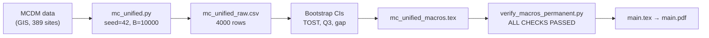

<p align="center">
  <h1 align="center">MCDM Landfill Pareto</h1>
  <p align="center">
    Source code, data, and manuscript for<br>
    <strong>Normalisation as implicit re-weighting in MCDM portfolio selection:<br>
    a factorial comparison on Fogo Island landfill siting</strong><br>
    <em>Omega – The International Journal of Management Science</em><br>
    <em>(under review)</em>
  </p>
</p>

<p align="center">
  <a href="https://www.python.org/"></a>
  <a href="https://numpy.org/"></a>
  <a href="https://pandas.pydata.org/"></a>
  <a href="https://scipy.org/"></a>
  <a href="https://creativecommons.org/licenses/by/4.0/"></a>
  <a href="https://doi.org/10.5281/zenodo.23676428"></a>
</p>

---

## Overview

This repository contains the full manuscript source and replication code for an article studying how the choice of normalisation method implicitly re-weights criteria in MCDM portfolio selection.

**Central question:** how much Pareto efficiency does normalisation choice cost in multi-criteria portfolio siting, and why?

We evaluate SAW and TOPSIS under min-max and vector normalisation across **1 944 653 feasible three-site portfolios** on Fogo Island, Cabo Verde. The Pareto frontier is computed exactly. Each cell's efficiency is measured as $Q_2$: the fraction of Monte Carlo draws in which the method's portfolio lies on the frontier.

**Main finding:** min-max normalisation recovers **+25.4 pp** more of the frontier than vector normalisation under greedy assembly. The difference is traced analytically to within-group amplitude distortion via the effective-weight identity $w_j^{\mathrm{eff}} \propto w_j A_j$.

---

## Key Results

### $Q_2$ by cell ($\kappa = 200$, 500 draws)

| Aggregation | Normalisation | Assembly | $Q_2$ (%) | $Q_3$ (%) | Cond. gap (%) |
|:-----------:|:-------------:|:--------:|----------:|----------:|--------------:|
| SAW | min-max | greedy | 86.0 | 0.18 | 1.3 |
| SAW | min-max | **optimal** | **100.0** | 0.00 | — |
| SAW | vector | greedy | 66.2 | 0.86 | 2.5 |
| SAW | vector | optimal | 56.8 | 0.87 | 2.0 |
| TOPSIS | min-max | greedy | 94.4 | 0.09 | 1.6 |
| TOPSIS | min-max | optimal | 96.6 | 0.05 | 1.4 |
| TOPSIS | vector | greedy | 63.4 | 1.14 | 3.1 |
| TOPSIS | vector | optimal | 52.4 | 1.11 | 2.3 |

SAW/min-max/optimal = 100% holds by Proposition 1 for any instance.  
$Q_3$ = expected gap as % of attainable range; conditional gap = $Q_3 / (1 - Q_2)$.

### Main contrasts (all from a single run, `seed=42`, `B=10 000`)

| Contrast | Effect (pp) | 95% CI |
|:---------|------------:|:------:|
| Normalisation, greedy | +25.4 | [+21.2, +29.7] |
| Normalisation, informative cells | +31.7 | [+27.7, +35.7] |
| Aggregation SAW − TOPSIS | −0.4 | [−2.1, +1.3] |
| Assembly × normalisation (TOPSIS) | +13.2 | [+9.6, +17.0] |
| Assembly, SAW/vector | −9.4 | [−12.4, −6.4] |
| Assembly, TOPSIS/vector | −11.0 | [−14.2, −7.8] |

Aggregation equivalence: TOST $p = 0.010$, $\delta = 2.5$ pp.

---

## Reproduction Pipeline



---

## Quick Start

### Requirements

- Python 3.12 with [uv](https://docs.astral.sh/uv/): `pip install uv`
- XeLaTeX (TeX Live 2023+ or MiKTeX)
- MCDM data (set `MCDM_DATA_DIR`; see below)

### Clone and run

```bash
git clone https://github.com/Jazancort/mcdm-landfill-pareto.git
cd mcdm-landfill-pareto
```

Set the data path (spatial dataset from [Azancort Neto 2026](https://zenodo.org/records/17704387)):

```bash
# Linux / macOS
export MCDM_DATA_DIR=/path/to/mcdm_data

# Windows
$env:MCDM_DATA_DIR = "C:\path\to\mcdm_data"
```

Run the unified experiment (all results from one script, one seed):

```bash
uv run python scripts/mc_unified.py
```

Expected output:

```
Assertao frac_gap0>=Q2: PASSOU em todas as 8 celulas.
TOST: mean=-0.40pp  90%CI=[-1.9,+1.1]  p=0.010
CONCLUIDO.
```

Runtime: ~4 min on GPU, ~9 min on CPU.

Verify all manuscript macros:

```bash
uv run python scripts/verify_macros_permanent.py
```

Expected: `ALL CHECKS PASSED`

---

## Import into Overleaf

1. On GitHub, click **Code → Download ZIP**
2. In Overleaf: **New Project → Upload Project** → select the ZIP
3. Set compiler to **XeLaTeX** and main file to `main.tex`
4. Click **Recompile**

All figure files (`figures/*.pdf`), class files (`cas-dc.cls`), and bibliography (`refs.bib`) are included in the repository.

---

## What Gets Verified

`verify_macros_permanent.py` recomputes every value from the raw data and asserts exact agreement (half-up rounding, 1 decimal place):

| Macro | Value | Source |
|:------|------:|:-------|
| `NormMainEffect` | 34.6 pp | C1: mean(minmax − vector), 4 cells |
| `NormGreedyContrast` | 25.4 pp | C6: greedy-only norm contrast |
| `QtwommGreedy` | 86.0% | SAW/minmax/greedy cell mean |
| `QtwommOptimal` | 100.0% | SAW/minmax/optimal (Prop. 1) |
| `QtwovecGreedy` | 66.2% | SAW/vector/greedy cell mean |
| `QtwovecOptimal` | 56.8% | SAW/vector/optimal cell mean |
| `EoneWloss` | 35.8 pp | 100 − Q₂(E1-W/optimal) |
| `EoneVloss` | 43.2 pp | 100 − Q₂(E1-V/optimal) |

---

## Key Assertions (enforced at runtime)

```python
# In mc_unified.py and q3_perdraw.py:
assert not (q2 == 1 and gap > 1e-9)        # efficient => gap = 0
assert frac_gap0[cell] >= Q2[cell]           # per cell

# In scoring.py:
# TOPSIS orientation test: dominant alternative scores 1.0 under both norms
```

---

## Repository Structure

```
mcdm-landfill-pareto/
├── main.tex                        XeLaTeX article (Elsevier CAS double-column)
├── macros.tex                      All numeric macros (auto-generated)
├── refs.bib                        Bibliography
├── supplementary.tex               Supplementary material
├── cas-dc.cls, cas-common.sty      Elsevier class files
│
├── figures/                        All figures (PDF + PNG)
│   ├── fig_F1_slope_weights.pdf
│   ├── fig_F2_interaction.pdf
│   ├── fig_F3_pareto.pdf
│   ├── fig_F4_map.pdf
│   ├── fig_F5_binary_amplitude.pdf
│   ├── fig_E5_synthetic.pdf
│   └── fig_workflow.png
│
├── scripts/
│   ├── mc_unified.py               Canonical: factorial + Q3 + bootstrap + macros
│   ├── scoring.py                  Single source of truth for SAW/TOPSIS scores
│   ├── q3_perdraw.py               Q3 per draw with assertions
│   ├── mcdm_experiment.py          Core MCDM module
│   ├── pareto_utils.py             Pareto dominance utilities
│   ├── verify_macros_permanent.py  CI: all macros vs raw data
│   └── compute_f8_circularity.py   F8 benchmark robustness
│
├── results/
│   ├── unified/                    Canonical results (mc_unified.py, seed=42)
│   │   ├── mc_unified_raw.csv      4000 rows: 8 cells × 500 draws
│   │   ├── mc_unified_contrasts.csv  Bootstrap CIs for 11 contrasts
│   │   ├── mc_unified_q3.csv       Q3, frac_gap0, conditional gap
│   │   └── mc_unified_macros.tex   Generated macros
│   ├── e1/                         E1 per-draw data
│   └── f8/                         F8 benchmark results
│
├── data/
│   ├── fogo_trios.npy              Pre-built trio index (1 944 653 trios)
│   └── ok_matrix.npy               Spatial feasibility matrix
│
└── corpus/
    ├── PRESPEC.md                  Pre-registered analysis plan
    └── PRESPEC_E1.md               E1 pre-specification
```

---

## Pre-Registration

`corpus/PRESPEC.md` and `corpus/PRESPEC_E1.md` were committed before the experiments ran. They record the estimand, rounding policy, assertion chain, and expected file hash.

---

## Citation

```bibtex
@article{AzancortNeto2026omega,
  author  = {Azancort Neto, Julio L.},
  title   = {Normalisation as implicit re-weighting in {MCDM} portfolio selection:
             a factorial comparison on {F}ogo {I}sland landfill siting},
  journal = {Omega},
  year    = {2026},
  doi     = {10.5281/zenodo.23676428},
  note    = {Under review}
}
```

---

## License

Code and data are released under [CC BY 4.0](https://creativecommons.org/licenses/by/4.0/).
